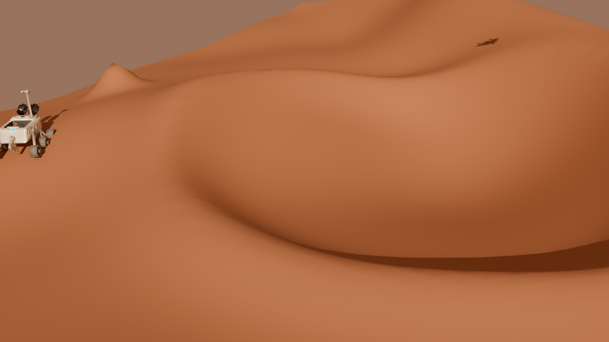
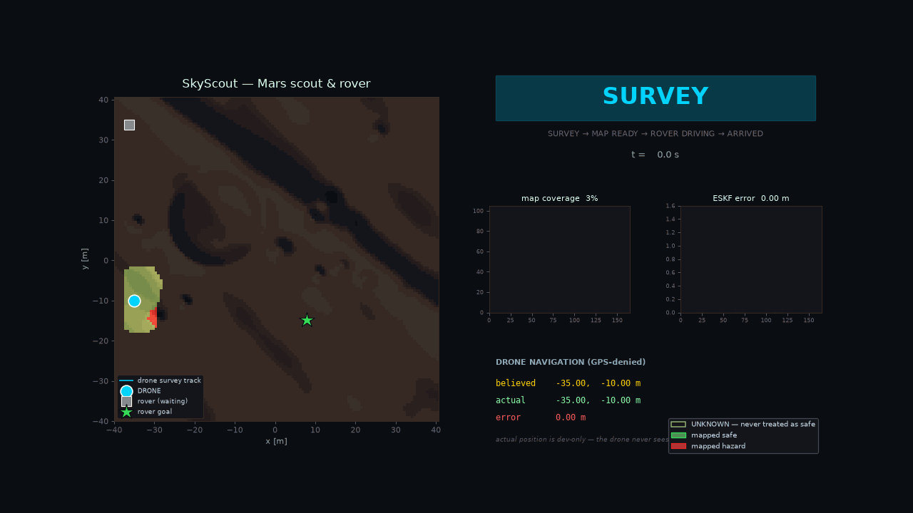
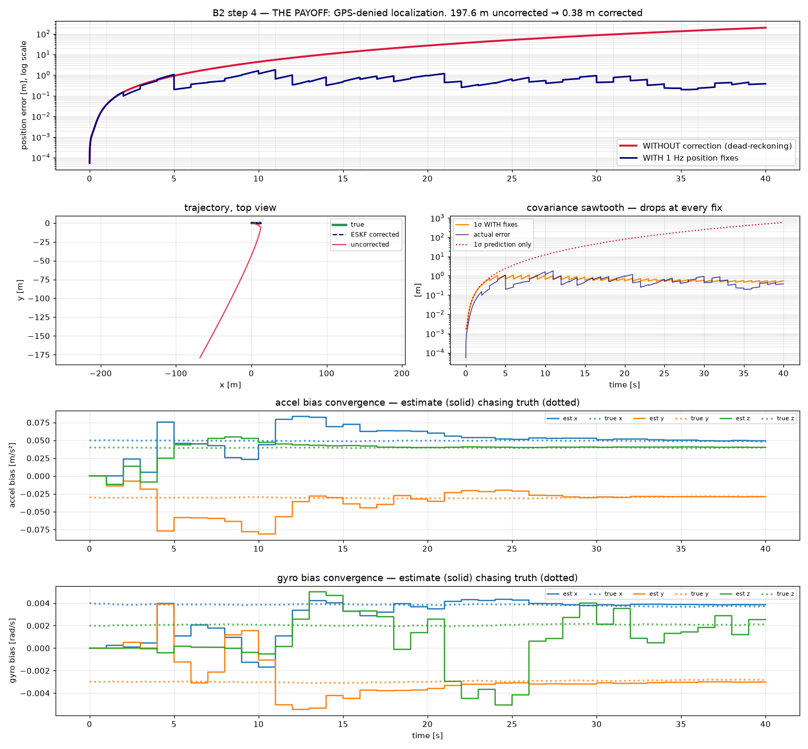
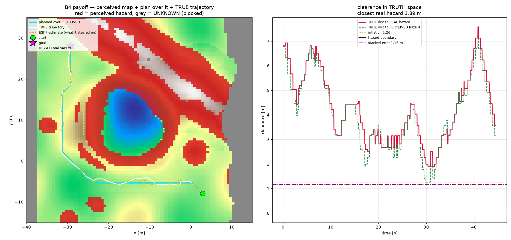
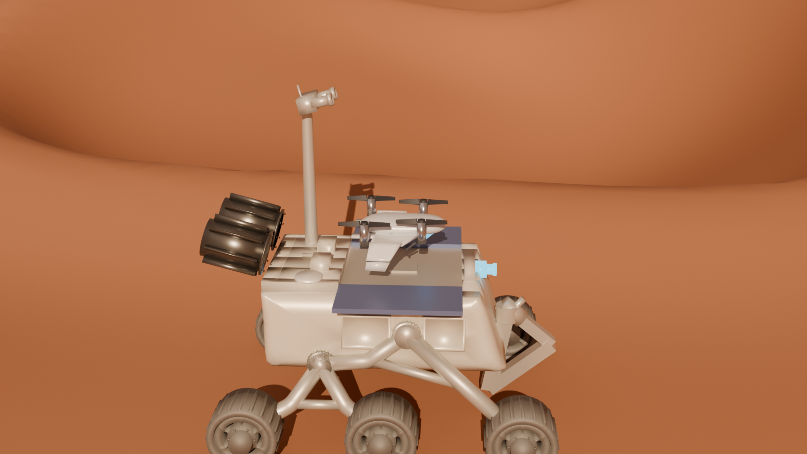
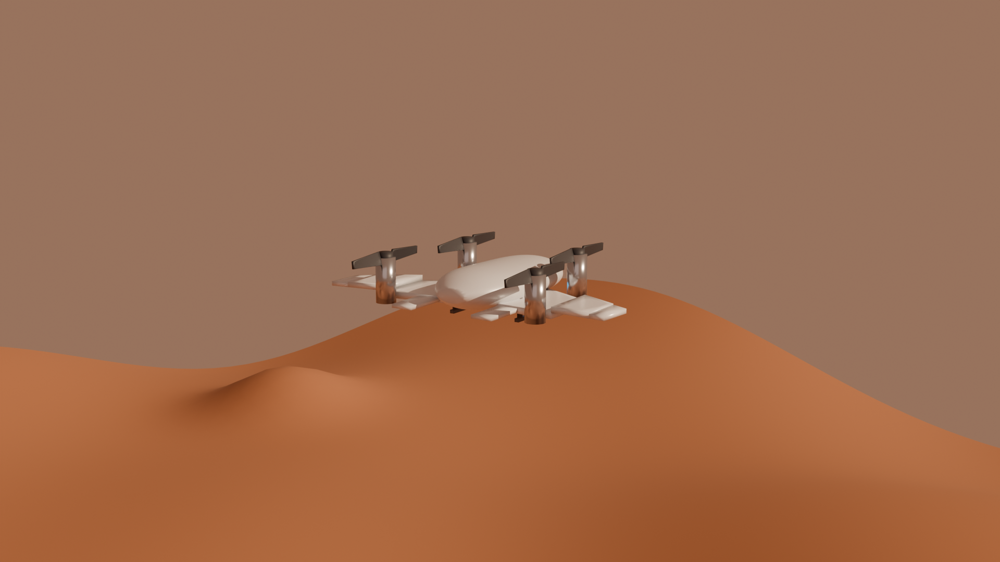
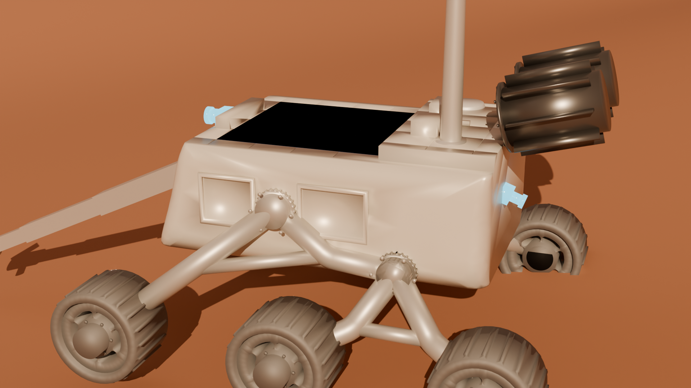

# SkyScout — Mars Aerial Scout + Ground Rover

**Thesis: the scout maps hazards from the air, the rover drives the safe route it found.**

A drone flies a GPS-denied, unknown Mars world, localizes with a from-scratch error-state Kalman
filter, judges terrain through its own downward camera, accumulates a persistent world hazard map,
and hands that map to a rocker-bogie rover that plans and drives a safe route across it — all shown
on one mission-control HUD.

Mars gravity −3.72 m/s². Built and verified entirely on CPU — AMD Ryzen 7 5700U with integrated
graphics under WSL2, **no GPU anywhere in the pipeline**.

[](renders/skyscout_scout_mission.mp4)

**[▶ Watch the 50 second mission video](renders/skyscout_scout_mission.mp4)**. The drone scouts ahead
while the rover drives the route it found. Geometry comes from the recorded simulation logs.



*The mission-control HUD. Map coverage climbs to 100% while the drone localizes without GPS, then
the rover is cleared to drive.*

Project write-up: [sankalpvertex.com/missions](https://sankalpvertex.com/missions)

> **Start here:** [`SKYSCOUT_RESUME.md`](SKYSCOUT_RESUME.md) — project context, scope, environment,
> phase map, verified results, and the standing engineering rules.

---

## Verified results

| Capability | Result |
|---|---|
| GPS-denied navigation | dead-reckoning drifts **197.6 m** in 40 s → ESKF holds **0.54 m** mean, 1.80 m max |
| Path planning | A\* detours 1.03× / 1.16× / 1.26×, zero blocked cells entered |
| Terrain perception | **0 missed hazards**, 2.3% false alarms on static captures |
| Autonomous mapping | 100% coverage, 2.5% miss / 6.1% false alarm, IoU 0.86 |
| Closing the loop | flew a route planned on its **own** map; closest real hazard 1.89 m vs a 1.16 m error budget |
| Rover autonomy | 85.0 m route over its own traversability, 0 undrivable cells entered |
| Rocker-bogie differential | chassis tilt 32.8° → 20.2°, rocker sum 62.2° → 1.4° |

Full breakdown, architecture diagram, and the failures that were caught along the way:
[`brain/README.md`](brain/README.md).

### The two results that matter most



*Without GPS, dead-reckoning drifts 197.6 m in 40 s. With a position fix once a second, the
filter ends the run 0.38 m from the truth. The bias estimates (bottom two panels) converge on the
injected values, which shows the filter observes the full state and does not just snap the position.*



*The drone plans over the map it built itself and flies it on its own position estimate. Scored
against the real terrain, the closest real hazard stays 1.89 m away, above the 1.16 m error budget.
Grey cells are unknown and are never treated as safe.*

## Gallery

<table>
  <tr>
    <td></td>
    <td></td>
  </tr>
  <tr>
    <td></td>
    <td></td>
  </tr>
</table>

## Repository layout

| Path | Contents |
|---|---|
| [`SKYSCOUT_RESUME.md`](SKYSCOUT_RESUME.md) | **Project context — read first.** Scope, environment, phase map, engineering rules. |
| [`brain/`](brain/) | **The sim runtime.** ESKF, planner, perception, rover loop, HUD, Blender pass — 63 Python modules plus their result plots and logs. |
| [`docs/design/`](docs/design/) | Track A body design: the brief, the v3 design spec, and two amendments. |
| `SKYSCOUT_B*.md` | Track B phase specifications (see table below). |
| [`scripts/`](scripts/) | URDF/SRDF pose and description validators. |
| [`renders/`](renders/) | Cinematic stills and mission videos from the B5-C Blender pass. |

## Phase specifications

| Phase | Deliverable |
|---|---|
| **B1** — [World foundation](SKYSCOUT_B1_PYBULLET.md) | Headless world + `terrain_height`; prove the drone loads, renders, and moves under a scripted command. No autonomy. |
| **B2** — ESKF | From-scratch 15-state error-state Kalman filter → `get_estimated_state()`. GPS-denied localization. |
| **B3** — A\* planner | `plan(tmap, start, goal)` over a `TraversabilityMap` taking a heightmap/cost array. |
| **B4** — [Perception](SKYSCOUT_B4_PERCEPTION.md) · [Step 3: Mapping](SKYSCOUT_B4_STEP3_MAPPING.md) | The drone builds the hazard map *itself* from depth + from-scratch GLCM texture analysis, removing B3's ground-truth cheat. |
| **B5** — [Rover + HUD](SKYSCOUT_B5_ROVER_HUD.md) | Rover (35 links / 34 joints, rocker-bogie, 6 wheels, helipad bay) plans over the drone's *perceived* map; HUD makes it legible. |
| **B5-C** — [Blender cinematic pass](SKYSCOUT_B5C_BLENDER.md) | CPU Cycles renders driven from the recorded trajectory logs — presentation only, no functional change. |

> **Note on B1's filename.** B1 was written for PyBullet; the project then moved to **Genesis
> (headless)**, which is what B2–B5C and every verified result use. The B1 document is kept as a
> historical record.

## Engineering rules

Standing constraints, applied in every phase:

- **Act only on what was perceived.** Perception is *scored* against ground truth; the system never
  *acts* on truth. The drone plans over the map it built.
- **`unknown` is never `safe`.** Unobserved cells stay a distinct third state, letting unknown read
  as safe is a miss generator.
- **Honest coupling.** `capture()` uses the TRUE body pose; `project()` uses the ESTIMATE. The gap
  between them is the map smear surfaced, not hidden.
- **Judge in truth space, one hand-check per claim.** Report **both** failure directions, miss vs.
  false-alarm, never a lone aggregate.

## Limitations

- **Simulation only.** No hardware was built or tested. Every result comes from a simulated Mars world.
- **One synthetic world.** The terrain is a procedural 80 × 80 m heightfield (fixed seed 20260808).
  The results show the pipeline works end to end on that world. They do not show it generalizes to
  other terrain or to real Mars imagery.
- **Scored against the simulator's own ground truth.** Perception is judged on terrain the same
  simulator generated, so the numbers say nothing about real sensor noise.
- **The cinematic pass is presentation.** The Blender renders replay recorded trajectory logs. The
  one shot with no logged motion (the rover reveal) uses authored poses, not simulated output.

## Running it

The runtime needs its own Python 3.12 venv and headless Genesis on CPU. See
[`brain/README.md`](brain/README.md) and [`brain/requirements.txt`](brain/requirements.txt) for the
pinned versions and per-phase commands. There is no live viewer on this hardware — **each phase is
judged on the PNGs, JSON, and NPZ files it writes**, which are committed alongside the code.

## External reference

The Track A CAD/body work was built against
**[earthtojake/text-to-cad](https://github.com/earthtojake/text-to-cad)** (v0.3.9), which played a
significant part in this project. It is a separate 2.1 GB upstream clone (35k files) and is
**intentionally not vendored** here — it is `.gitignore`d and referenced instead. To work with that
part of the pipeline, clone it alongside this repo:

```bash
git clone https://github.com/earthtojake/text-to-cad.git
```

The two validators in [`scripts/`](scripts/) were written for that toolchain and are version-controlled
here so they travel with this project:

- [`check-skyscout-poses.py`](scripts/check-skyscout-poses.py) — validates SRDF named poses, the
  deployment choreography, and the lift-off-before-tilt constraint. FK from the URDFs plus OBB
  separating-axis tests on the collision pairs that stay enabled. Cylinders and meshes are bounded by
  their enclosing box, so the test is deliberately **conservative**: a reported clear pair is truly
  clear; a reported hit may be the bounding box and prints its depth for triage.
- [`check-robot-descriptions.py`](scripts/check-robot-descriptions.py) — robot description validation.

Large meshes are not committed; point `SKYSCOUT_MODELS` at them or drop them in `brain/models/`.

---

<sub>Music in the mission clip: “Solarflex” via Pixabay.</sub>
