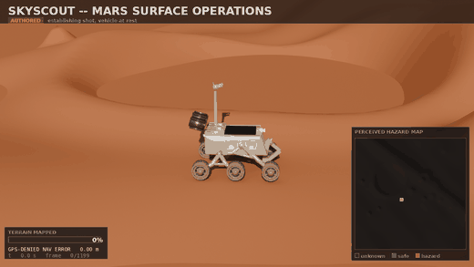
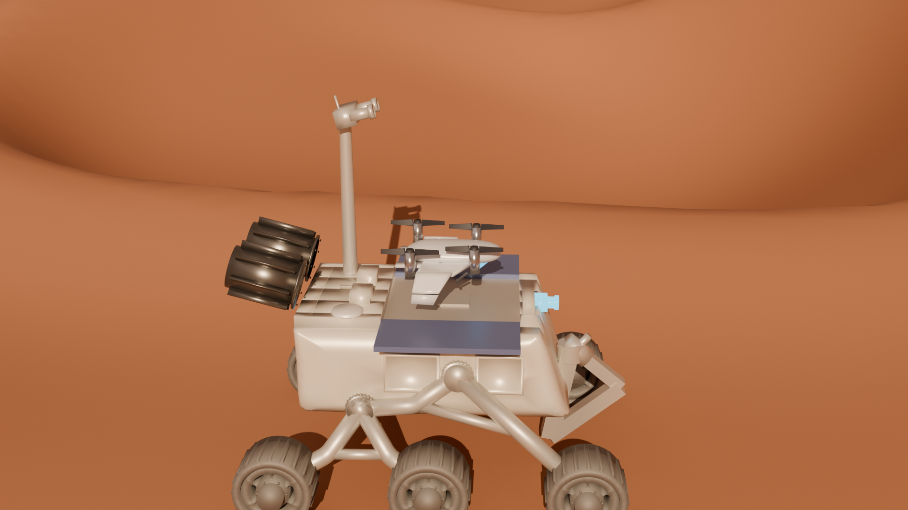
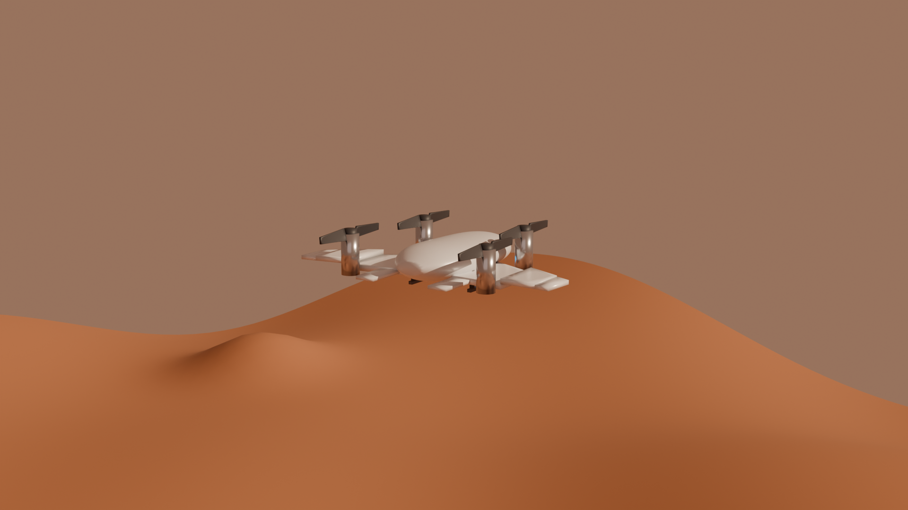
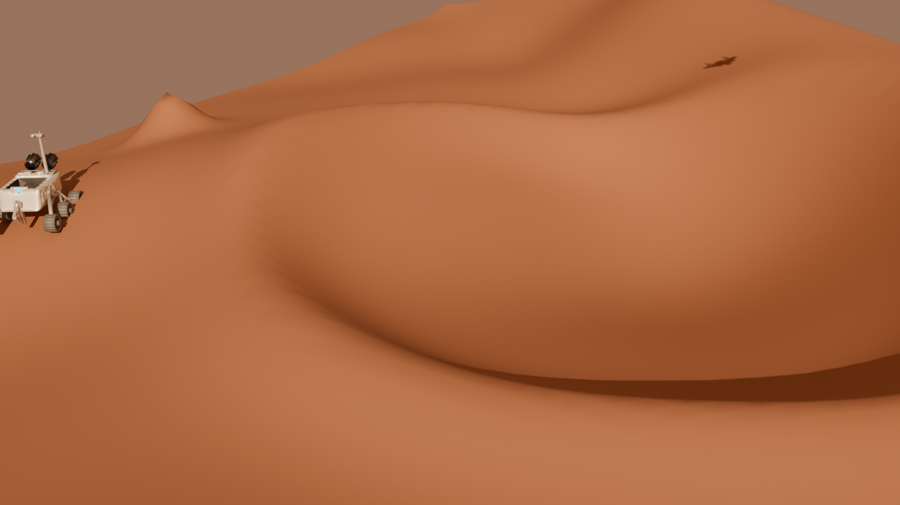
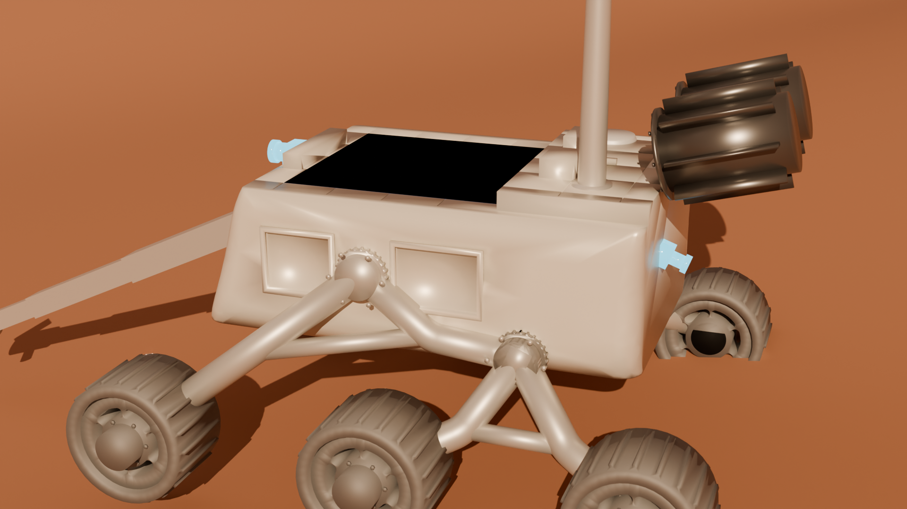

<div align="center">

# SkyScout

**A Mars scout drone that maps unknown terrain from its own camera — and a rover that drives the routes it found.**

No GPS. No pre-loaded map. No ground truth anywhere in the decision path.



📽️ **[Watch the full 50-second mission clip →](renders/skyscout_scout_mission.mp4)**

</div>

---

## The idea

A rover carries a folding tilt-rotor drone in a sealed deck bay. On arrival the deck opens, the drone
deploys, flies a survey of terrain **nobody has mapped**, builds a hazard map from its own downward
camera while navigating **without GPS**, returns and stows itself — and the rover then plans and drives
a safe route over the map the drone just made.

Every layer is built from scratch and verified against ground truth **after the fact only**. Truth is
used for scoring, never for flying.

---

## What actually works

| capability | result | how it's judged |
|---|---|---|
| **GPS-denied navigation** | dead-reckoning drifts **197.6 m** in 40 s → ESKF holds **0.54 m** mean, 1.80 m max | position error vs ground truth |
| **Path planning** | A\* detours **1.03× / 1.16× / 1.26×**, zero blocked cells entered, unreachable pair correctly refused | plan validity + detour sanity |
| **Terrain perception** | **0 missed hazards**, 2.3% false alarms on static captures | confusion matrix vs truth |
| **Autonomous mapping** | **100% coverage**, 2.5% miss / 6.1% false alarm, IoU 0.86 | perceived map vs truth map |
| **Closing the loop** | flew a route planned on its **own** map; closest real hazard **1.89 m** vs a 1.16 m stacked error budget | truth-space clearance |
| **Rover autonomy** | 85.0 m route over its own traversability, **0 undrivable cells entered** | truth-space re-check |
| **Rocker-bogie differential** | chassis tilt **32.8° → 20.2°**, rocker sum 62.2° → 1.4° | physics-driven step climb |

---

## Architecture

```
                        ┌──────────────────────────────────────┐
   Genesis (headless)   │  Mars world · seed 20260808          │
   Mars gravity −3.72   │  80×80 m · crater · ridge · boulders │
                        └───────────────┬──────────────────────┘
                                        │ truth (scoring only)
   ┌────────────────────────────────────┼────────────────────────────────────┐
   │                          THE DECISION PATH                              │
   │                                                                         │
   │   IMU 240 Hz ──▶ ESKF ──▶ position estimate ──┐                          │
   │   (noise + bias)  15-state                    │                          │
   │                   error-state                 ▼                          │
   │                                        flight controller                 │
   │   downward camera ──▶ depth ──▶ hazard ──▶ world hazard map ──▶ A*        │
   │   (planar-z, 60°)     +GLCM     score      (log-odds fusion)    planner  │
   │                                             unknown ≠ safe               │
   │                                                    │                     │
   │                                                    ▼                     │
   │                                        rover traversability ──▶ A* ──▶ drive
   │                                        (slope 20° · step = wheel radius) │
   └─────────────────────────────────────────────────────────────────────────┘
```

### Build phases

| phase | what it adds |
|---|---|
| **B1** | Genesis headless world, Mars gravity, procedural terrain, scripted flight |
| **B2** | Simulated IMU + **from-scratch ESKF** — nominal state, 15-dim error state, Joseph-form update, reset Jacobian |
| **B3** | Traversability cost map (slope + top-hat prominence) and **A\*** flown on the ESKF estimate |
| **B4** | **Perception**: depth → per-patch hazard score → persistent world map, then plan over *that* |
| **B5** | **Rover**: its own traversability, A\* route, rocker-bogie differential, mission HUD |
| **B5C** | Blender cinematic pass driven from the recorded logs |

---

## The mission clip

50 seconds, driven **entirely from recorded trajectory logs** — nothing re-simulated for the render.

| beat | length | source |
|---|---|---|
| Establish | 2.0 s | authored camera |
| Deploy | 3.0 s | authored (SRDF named poses) |
| Depart | 2.5 s | authored transit |
| **Scan** | **25.0 s** | **logged** — the recorded survey at 6.6× |
| Return | 2.5 s | authored transit |
| Land | 4.0 s | authored (deploy reversed) |
| **Drive** | **11.0 s** | **logged** — the A\* route over the perceived map |

36 of the 50 seconds are replayed straight from the mission. Beats are tagged **LOGGED** or **AUTHORED**
on screen, and the scanning inset shows the hazard map filling in cell by cell — every cell turns green
or red on the frame the recorded survey actually observed it.

<div align="center">
 
 
</div>

---

## Things that were wrong, and how they were caught

The interesting engineering here is mostly in the failures. A few that mattered:

- **A passing test that tested nothing.** The estimate-guided flight came back *bit-identical* to the
  truth-guided one in 2011 of 2061 samples. The PD controller closed its loop on ground truth
  regardless of the guidance switch, so localization error could not possibly degrade it.
- **A feature with exactly zero information.** GLCM roughness was quantized over ±0.35 m when the
  residuals are centimetre-scale. Measured hazard-vs-safe separation: **+0.001**. At ±0.05 m: **+0.539**.
- **A drone that slowly fell over.** The base attitude DOFs were uncontrolled. Tilt reached 27° by
  t=35 s and 176° over a 166 s survey. Earlier phases only flew 14–43 s, so nothing ever noticed.
- **Depth that was not what it looked like.** Genesis returns planar z-depth, not Euclidean range.
  Identical at the image centre, ~22% off at the corners. Settled by scoring all four
  depth/FOV convention combinations: **0.002 m RMS** for the winner vs 0.84+ for the rest.
- **A map that fabricated obstacles at its own edges.** Filling unobserved cells then running a 4 m
  top-hat invented prominence in a band covering ~40% of every frame.

---

## Running it

**Environment.** Genesis runs **headless on CPU** — there is no GPU and no live viewer on this
machine (AMD Ryzen 7 5700U, integrated Radeon, WSL2). Mars gravity is set to **−3.72 m/s²**
throughout. Every phase therefore **judges itself on written artifacts, not a live window**: each
script drops PNG plots, JSON/NPZ result files, and frame sequences next to itself. After a run,
**look at the emitted `.png` and `.json`, not at a viewport** — that is the intended interface, and
it is why the verification habits below are written the way they are.

Exact pinned versions are in [`requirements.txt`](requirements.txt); the venv lives in
`.venv-genesis/` and is gitignored.

```bash
# Python 3.12, its own venv — keep it separate from the text-to-cad .venv
python3.12 -m venv .venv-genesis

# torch must be the CPU wheel (see requirements.txt for why)
.venv-genesis/bin/pip install torch==2.13.0 --index-url https://download.pytorch.org/whl/cpu
.venv-genesis/bin/pip install -r requirements.txt

.venv-genesis/bin/python b2_step4_correct.py      # ESKF vs dead reckoning
.venv-genesis/bin/python b3_step4_estimate.py     # A* flown on the estimate
.venv-genesis/bin/python b4_step3_mapping.py      # build the perceived map
.venv-genesis/bin/python b4_step4_closeloop.py    # plan over the perceived map
.venv-genesis/bin/python b5_a2_rover_drive.py     # rover route + differential test
```

Cinematic pass (needs [Blender 4.5 LTS](https://www.blender.org/download/lts/) and the
drone/rover URDFs — point `SKYSCOUT_MODELS` at them, or drop them in `models/`):

```bash
export SKYSCOUT_MODELS=/path/to/models/
./run_scout_clip.sh          # render → scan overlay → MP4
```

---

## Stack

**Genesis** headless CPU physics · **NumPy/SciPy** for the ESKF, GLCM and planners · **Blender Cycles**
for the renders · **Matplotlib/PIL** for analysis plots and the HUD. Runs entirely on CPU — no GPU
anywhere in the pipeline.

---

<div align="center">
<sub>Music in the mission clip: “Solarflex” via Pixabay.</sub>
</div>
